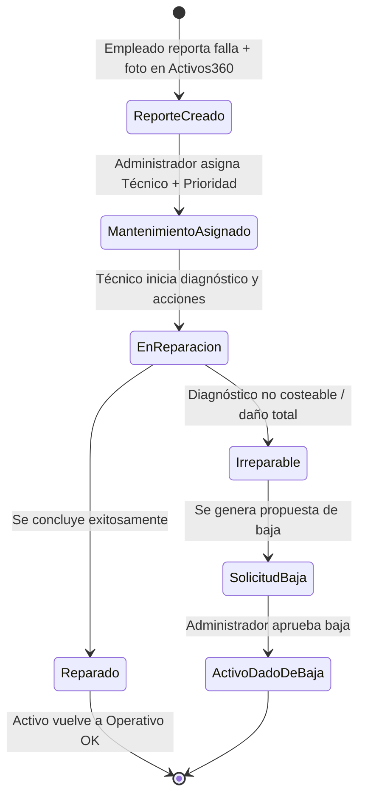

# ItheraStorage (Activos360 / SIRMA)

Plataforma corporativa e institucional integral para la **gestión, control, trazabilidad, resguardo físico y ciclo de vida de activos fijos y bienes institucionales** (equipo de cómputo, mobiliario, herramientas operativas y recursos de infraestructura).

---

## 1. Visión General del Proyecto

**ItheraStorage** (denominado técnicamente en el backend como **SIRMA** —*Sistema Integral de Resguardo y Mantenimiento de Activos*— y en dispositivos móviles como **Activos360**) elimina la dependencia de bitácoras en papel y hojas de cálculo desincronizadas mediante una **arquitectura en tres componentes**:

1. **Backend & Lógica de Negocio (`back/sirma`):** API RESTful desarrollada en Java 21 y Spring Boot con seguridad basada en roles (JWT Stateless), persistencia en la nube y sincronización reactiva en tiempo real.
2. **Portal Web Administrativo (`front/gestion_inventario`):** Dashboard analítico e interfaz de gestión para administradores desarrollada en React 19 y Vite con actualización en vivo vía Server-Sent Events (SSE).
3. **Aplicación Móvil de Campo (`mobile-andoid/Activos360`):** App nativa Android desarrollada en Kotlin y Jetpack Compose, con escaneo por hardware de códigos QR/barras y módulos de resguardo y mantenimiento para empleados y técnicos.

---

## 2. Diagnóstico del Negocio y Problemática que Resuelve (Gap Analysis)

| Dimensión | Situación Anterior (**AS-IS**) | Solución Implementada (**TO-BE: ItheraStorage**) |
| :--- | :--- | :--- |
| **Captura de Datos** | Lápiz y papel; captura diferida en hojas de `Excel`; errores de captura en números de serie. | **Digitalización en el punto de operación**: App móvil Android con escáner de códigos QR y códigos de barras por hardware (Google Play Services Code Scanner) y captura fotográfica de evidencias. |
| **Arquitectura de Datos** | Archivos dispersos por departamento; información aislada en silos locales sin respaldo único. | **Repositorio centralizado de alta disponibilidad**: Base de datos relacional en la nube (AWS RDS MySQL 8.0), con auditoría transaccional e integridad referencial estricta. |
| **Cadena de Custodia** | Asignaciones verbales o firmas en hojas sueltas que se extravían; nula validez probatoria. | **Flujo digital de resguardo en 3 fases**: Asignación por Administrador $\rightarrow$ Confirmación/Recepción con Checklist por el Empleado $\rightarrow$ Devolución auditada. |
| **Mantenimientos y Fallas** | Reportes informales por chat o correo; activos dañados acumulados sin diagnóstico ni prioridad. | **Módulo unificado de soporte técnico**: Reporte de incidencia con fotografía $\rightarrow$ Asignación de técnico y prioridad $\rightarrow$ Diagnóstico, refacciones y dictamen final (Reparado / Irreparable). |
| **Actualización en Tiempo Real** | Hasta 15 días hábiles para consolidar reportes de inventario disponible y depreciación. | **Reactivación instantánea**: Transmisión de eventos de servidor (**SSE - Server-Sent Events**) que refresca automáticamente el portal web ante cualquier movimiento físico o administrativo. |

---

## 3. Arquitectura Global del Sistema

```mermaid
flowchart TD
    subgraph Clientes ["Capa de Presentación"]
        WEB["Portal Web Admin (React 19 + Vite)<br/>• Dashboard KPIs<br/>• Gestión de Activos y Catálogos<br/>• Aprobación de Bajas y Usuarios"]
        APP["App Móvil Activos360 (Kotlin + Compose)<br/>• Escaneo QR/Barras rápido<br/>• Rol Empleado (Resguardos, Reportes)<br/>• Rol Técnico (Mantenimiento en campo)"]
    end

    subgraph Backend ["Capa de Lógica y Servicios (SIRMA API)"]
        SPRING["Spring Boot 4 / Java 21<br/>• Spring Security + JWT Stateless<br/>• Motor SSE (Eventos en Tiempo Real)<br/>• SAX Streaming Excel Import<br/>• Motor Cifrado AES-GCM (QR Seguro)<br/>• Generador de Etiquetas PDF (ZXing + OpenPDF)"]
    end

    subgraph Infraestructura ["Capa de Persistencia y Terceros"]
        DB[(AWS RDS / MySQL 8.0<br/>Transaccional, Triggers, Columnas Calculadas)]
        S3["Amazon Web Services S3<br/>Imágenes de Activos, Evidencias y Perfiles"]
        MAIL["Servicio SMTP (Gmail)<br/>Contraseñas temporales y enlaces de reseteo"]
    end

    WEB <-->|HTTPS / REST API + SSE| SPRING
    APP <-->|HTTPS / REST API (Retrofit2)| SPRING
    SPRING <-->|JPA / Hibernate / JDBC| DB
    SPRING <-->|AWS SDK v2 S3Client| S3
    SPRING <-->|JavaMailSender| MAIL
```

---

## 4. Modelo de Dominio y Lógica de Negocio

### 4.1. Arquitectura de Doble Estado del Activo (Dual-State Pattern)
Separación estricta entre la custodia física del activo y su condición funcional:

```
[ ACTIVO ]
   ├── Estado de Custodia  ───> ¿Quién posee físicamente el bien?
   └── Estado Operativo    ───> ¿En qué condición funcional está el bien?
```

* **Estados de Custodia (`estado_custodia`)**:
  * `Disponible`: En almacén o bodega, listo para ser asignado.
  * `En Proceso`: Orden de resguardo emitida por el Administrador, pendiente de aceptación por el colaborador.
  * `Resguardado`: Colaborador recibió el activo, inspeccionó el checklist físico y confirmó la custodia legal.
* **Estados Operativos (`estado_operativo`)**:
  * `OK`: Activo en óptimas condiciones de operación.
  * `Reportado`: Incidencia o avería reportada (la custodia física puede seguir con el colaborador).
  * `Mantenimiento`: Técnico asignado para servicio preventivo o correctivo.
  * `Baja`: Activo dictaminado como irreparable u obsoleto, desincorporado del inventario activo.

---

### 4.2. Ciclos de Vida y Flujos Operativos

#### A. Alta de Activos (Manual y Masiva)
* **Alta Individual:** Registro de especificaciones técnicas, número de serie, tipo de bien (mueble/inmueble), costo, espacio físico y generación de etiqueta.
* **Importación Masiva Excel (`.xlsx`):** Motor de importación basado en streaming SAX (`XSSFReader` + `XSSFSheetXMLHandler` de Apache POI) de bajo consumo de memoria. Valida y provisiona dinámicamente catálogos faltantes o reporta inconsistencias detalladas por fila.
* **Generación de Etiquetas QR Cifradas:**
  * Cifrado criptográfico con `QrPayloadCodec` usando **AES-GCM (128-bit tag)** para generar tokens compactos Base64URL embebidos en el QR (`{"v":2,"p":"..."}`), evitando la falsificación o lectura directa de IDs de base de datos.
  * Generación de etiquetas en PDF listas para impresión física (ZXing + OpenPDF).

#### B. Resguardos y Cadena de Custodia
1. **Asignación:** Administrador asigna el activo disponible a un usuario colaborador.
2. **Validación:** El activo pasa a `En Proceso` y se notifica al empleado en la app móvil.
3. **Inspección Física (Checklist):** El colaborador verifica cada elemento de entrega (`OK`, `Falla`, `No Aplica`).
4. **Confirmación Digital:** Al confirmar, pasa a `Resguardado`. La base de datos garantiza unicidad mediante la columna generada condicional `centinela_activo` para impedir dobles resguardos activos.
5. **Devolución:** Se realiza la verificación de entrega y el bien retorna a estado `Disponible`.

#### C. Mantenimientos e Incidencias Técnicas


* **Reporte de Incidencia:** Levantado por el empleado o técnico desde la app con descripción, nivel de prioridad y evidencia fotográfica en Cloudinary.
* **Mantenimiento Técnico:** Asignación de técnico, tipo (Correctivo/Preventivo), diagnóstico, refacciones utilizadas, costos y dictamen final (`Reparado` o `Irreparable`).
* **Solicitud de Baja Definitiva:** Si un activo es dictaminado como irreparable, se envía un expediente de baja (`SolicitudBaja`) para su aprobación o rechazo por el Administrador.

#### D. Pista de Auditoría (`Bitacora`)
Registro inmutable de cualquier alteración en el inventario:
* Activo y usuario responsable de la acción.
* Tipo de evento (`Creación`, `Asignación`, `Devolución`, `Reporte de Falla`, `Mantenimiento`, `Baja`).
* Registro histórico de estados: `estado_custodia_anterior` $\rightarrow$ `estado_custodia_nuevo` y `estado_operativo_anterior` $\rightarrow$ `estado_operativo_nuevo`.
* Estampa de tiempo exacta persistida automáticamente.

---

### 4.3. Jerarquía Espacial y Catálogos

Estructuración de ubicación física:
$$\text{Campus} \longrightarrow \text{Edificio} \longrightarrow \text{Espacio (Aula, Bodega, Laboratorio, Taller)} \longrightarrow \text{Activo}$$

Catálogos adicionales de soporte:
* **Áreas Organizacionales:** Asignación departamental (Recursos Humanos, TI, etc.).
* **Tipos de Activo:** Clasificación de bienes (Mueble / Inmueble) asociados a Marcas y Modelos.
* **Prioridades y Tipos de Falla:** Estandarización de incidencias para soporte técnico.

---

## 5. Especificaciones Técnicas por Módulo

### 5.1. Backend (`back/sirma`)
* **Lenguaje & Framework:** Java 21, Spring Boot 4.0.3.
* **Persistencia:** Spring Data JPA con Hibernate, MySQL Connector/J 9.4.0.
* **Base de Datos:** TiDB Cloud Serverless (MySQL Compatible) con conexión segura SSL/TLS.
* **Seguridad:** Spring Security con JWT Stateless (`io.jsonwebtoken 0.11.5`) y control de acceso basado en roles (RBAC: `ROLE_Administrador`, `ROLE_Tecnico`, `ROLE_Empleado`).
* **Primer Inicio de Sesión:** Detección de `primer_login = true` con respuesta `403 FORBIDDEN` y bandera obligatoria de cambio de contraseña previo a la emisión de credenciales finales.
* **Eventos en Tiempo Real (SSE):** Canal reactivo en `/api/eventos` (`SseEmitterService`) para notificaciones automáticas al panel web.
* **Servicios Multimedia:** SDK de Cloudinary para carga y gestión de imágenes en la nube (fotos de activos, fotos de perfil y evidencias de falla).
* **Documentación API:** SpringDoc OpenAPI 3.0.1 con interfaz Swagger UI y exportación `api-docs.json`.

### 5.2. Frontend Web Administrativo (`front/gestion_inventario`)
* **Stack:** React 19.2.0, Vite 7.3.1.
* **Manejo de Estado y Caché:** `@tanstack/react-query` v5 integrado con SSE (`useLiveUpdates.js`) para invalidación de queries en tiempo real.
* **Diseño y Estilos:**
  * Variables de diseño inspiradas en **Moon Design System** (`theme.css`).
  * `styled-components` y primitivas accesibles de Radix UI (`@radix-ui/react-alert-dialog`, `@radix-ui/react-tooltip`).
  * Iconografía: `@heathmont/moon-icons`, `lucide-react` y `bootstrap-icons`.
  * Notificaciones visuales: `sonner`.
  * Gráficos analíticos: `recharts`.
* **Vistas del Sistema:**
  * **Dashboard:** Indicadores clave (KPIs), gráficas de estado de inventario y distribución de activos.
  * **Activos:** Catálogo interactivo con paginación en servidor, filtros dinámicos, ficha técnica, generación de QR e importación masiva Excel.
  * **Solicitudes:** Bandeja para asignación de técnicos a incidencias y autorización de solicitudes de baja.
  * **Catálogos:** Mantenimiento de la jerarquía física (Campus, Edificios, Espacios) y tipos de activos.
  * **Usuarios:** Alta de personal con despacho automático de contraseñas temporales por correo.

### 5.3. Aplicación Móvil Android (`mobile-andoid/Activos360`)
* **Stack:** Kotlin, Jetpack Compose (UI declarativa moderna), Target SDK 36, Min SDK 24.
* **Integración API Automática:** Plugin Gradle `org.openapi.generator` (versión 7.5.0) para compilar la especificación OpenAPI (`api-docs.json`) en clientes Retrofit 2 + Moshi con soporte nativo de corrutinas (`suspend fun`).
* **Escaneo de Hardware:** Google Play Services Code Scanner (`play-services-code-scanner:16.1.0`), lectura rápida de QR y códigos de barras sin solicitar permisos invasivos de cámara.
* **Renderizado Multimedia:** Coil Compose para consumo eficiente de imágenes desde Cloudinary.
* **Flujos por Rol:**
  * **Empleado:** Consulta de resguardos activos, escaneo de activos, confirmación con checklist, reporte de fallas y solicitud de devolución.
  * **Técnico:** Tablero de órdenes de trabajo, registro de intervenciones, refacciones, costos y dictamen final de reparación o baja.

---

## 6. Matriz de Roles y Permisos

| Módulo / Funcionalidad | Administrador (Web) | Técnico (Móvil / Web) | Empleado (Móvil) |
| :--- | :---: | :---: | :---: |
| **Dashboard y Métricas Ejecutivas** | Total | Restringido | Sin acceso |
| **Alta y Edición de Activos** | Total | Solo lectura | Sin acceso |
| **Importación Masiva de Excel** | Total | Sin acceso | Sin acceso |
| **Generación e Impresión de Etiquetas QR** | Total | Consulta QR | Sin acceso |
| **Asignar Resguardo a Personal** | Total | Sin acceso | Sin acceso |
| **Confirmar / Devolver Resguardo** | Supervisión | Sin acceso | **Total (App Móvil)** |
| **Levantar Reporte de Daño / Falla** | Total | Total | **Total (App Móvil)** |
| **Ejecutar Mantenimiento y Diagnóstico** | Supervisión | **Total (App Móvil)** | Sin acceso |
| **Aprobar / Rechazar Bajas Definitivas** | **Total** | Solo propuesta | Sin acceso |
| **Gestión de Catálogos y Usuarios** | Total | Sin acceso | Sin acceso |

---

## 7. Estructura del Repositorio

```text
ItheraStorage/
├── back/
│   └── sirma/                    # Backend Spring Boot 4 + Java 21
│       ├── src/main/java/mx/edu/utez/
│       │   ├── config/           # Configuraciones generales y CORS
│       │   ├── kernel/           # Clases base, respuestas estándar y SSE
│       │   ├── modules/          # Módulos de dominio (core, location, maintenance, media, reporting, security)
│       │   ├── security/         # Configuración JWT y filtros de autenticación
│       │   └── util/             # Utilerías (Cloudinary, QR Codec AES-GCM, Excepciones)
│       └── pom.xml
├── front/
│   └── gestion_inventario/       # Frontend Web React 19 + Vite
│       ├── src/
│       │   ├── api/              # Clientes de consumo REST
│       │   ├── components/       # Sistema de diseño y componentes UI reutilizables
│       │   ├── hooks/            # Hooks personalizados (useLiveUpdates, usePaginatedQuery)
│       │   ├── modules/          # Módulos de administración y vistas públicas
│       │   ├── routes/           # Enrutamiento React Router (Admin y Público)
│       │   └── styles/           # Tokens de diseño Moon Design System
│       └── package.json
└── mobile-andoid/
    └── Activos360/               # Aplicación Móvil Android (Kotlin + Jetpack Compose)
        ├── app/
        │   ├── src/main/java/com/example/activos360/
        │   │   ├── back/         # Modelos y APIs (consumo OpenAPI / Retrofit2)
        │   │   ├── core/         # Manejo de tokens y utilidades
        │   │   └── ui/           # Pantallas, navegación Compose y ViewModels (Empleado, Técnico, Login)
        │   └── build.gradle.kts  # Configuración Gradle con OpenAPI Generator
        └── specs/api-docs.json   # Contrato OpenAPI exportado desde el backend
```
